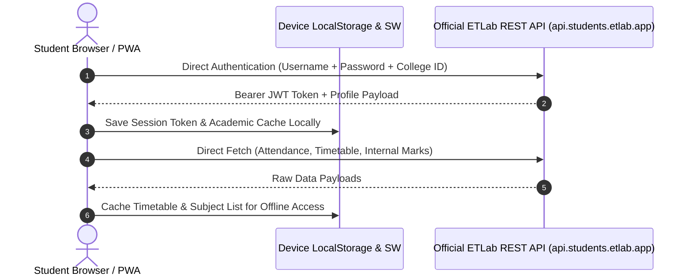

<p align="center">
  <a href="https://github.com/nimd/etbridge">
    
  </a>
</p>

<h1 align="center">ETBridge</h1>

<p align="center">
  An open-source, client-side web interface and Progressive Web App for students using the ETLab portal.
  <br />
  Fast, clean, offline-ready, with automated 75% bunk margin calculations and self-reported duty leave tracking.
</p>

<p align="center">
  <a href="LICENSE">
    
  </a>
  <a href="https://www.typescriptlang.org/">
    
  </a>
  <a href="https://react.dev/">
    
  </a>
  <a href="https://vitejs.dev/">
    
  </a>
  <a href="https://web.dev/progressive-web-apps/">
    
  </a>
  <a href="https://github.com/nimd/etbridge">
    
  </a>
</p>

---

## Contents

- [Overview](#overview)
- [Motivation](#motivation)
- [Architecture & Security](#architecture--security)
- [Key Features](#key-features)
  - [Attendance & 75% Cutoff Calculation](#attendance--75-cutoff-calculation)
  - [Duty Leave Projection](#duty-leave-projection)
  - [Live Timetable & Substitutions](#live-timetable--substitutions)
  - [Offline Caching](#offline-caching)
- [Mobile PWA Installation](#mobile-pwa-installation)
- [Local Development](#local-development)
- [Deployment](#deployment)
- [Supported Institutions](#supported-institutions)
- [About the Author](#about-the-author)
- [License & Legal Disclaimer](#license--legal-disclaimer)

---

## Overview

ETBridge is a community-built web application designed for university students whose colleges utilize the ETLab academic management platform. It acts as a lightweight, reactive presentation layer on top of ETLab's official student REST API.

Unlike wrapped webview applications, ETBridge executes entirely inside the user's browser, stores session state locally, and offers utilities specifically built for day-to-day student needs — such as safe bunk margin projections and duty leave tracking.

---

## Motivation

The official ETLab mobile application has long suffered from stability, performance, and user-experience issues:

- Protracted startup times and frequent session expirations.
- Sluggish webview rendering that reloads full pages on simple interactions.
- Fragmented navigation that buries vital metrics (like subject-wise attendance percentages and duty leaves) behind multiple nested menus.
- Complete unavailability during brief network drops in lecture halls.

ETBridge was built to provide a clean, modern alternative: instantaneous cold starts, transparent attendance calculations, offline caching, and respectful zero-knowledge data handling.

---

## Architecture & Security

ETBridge follows a 100% static, client-side zero-knowledge architecture. There is no custom backend, proxy server, or middleman database.



### Security Guarantees

1. **Direct API Communication**: Every network request travels straight from your browser or PWA container to ETLab's official server (`https://api.students.etlab.app`).
2. **Zero Credential Logging**: Credentials and authentication tokens are kept strictly in browser `localStorage`. No intermediary server ever sees, processes, or logs student data.
3. **Auditable Codebase**: The entire implementation is open-source under the MIT license, enabling complete community code review.

---

## Key Features

### Attendance & 75% Cutoff Calculation

University regulations typically enforce a mandatory 75% attendance threshold per course to qualify for semester examinations. ETBridge automatically calculates exact attendance margins for every subject:

- **When attendance is at or above 75% (Safe)**:
  It computes the exact number of future consecutive lecture hours you can afford to miss without dipping below 75%:

  $$\text{Bunkable Classes} = \left\lfloor \frac{P - 0.75 \times T}{0.75} \right\rfloor$$

  *(where $P$ is present hours and $T$ is total conducted hours).*

- **When attendance is below 75% (Shortage)**:
  It computes the exact number of consecutive upcoming lecture hours you must attend to cross the 75% threshold:

  $$\text{Required Classes} = \left\lceil \frac{0.75 \times T - P}{0.25} \right\rceil$$

### Duty Leave Projection

Official duty leave entries submitted to faculty coordinators often take days or weeks to be verified and entered into the ETLab database. During this window, student attendance numbers appear artificially low.

- ETBridge allows students to log their approved duty leaves by selecting the specific hours of the day (e.g. Periods 4, 5, 6).
- The application dynamically computes projected attendance percentages and updated bunk limits.
- Projected hours are marked with distinct labels so they are never confused with official university records.
- Once faculty officially enters the record in ETLab, ETBridge detects the match and reconciles the pending record automatically.

### Live Timetable & Substitutions

- Detects ongoing and upcoming lecture periods in real time using the device's local clock.
- Identifies faculty substitution assignments and flags altered routines clearly.
- Day-wise routine viewer formatted to Indian academic timetable conventions (`DD/MM/YYYY`).

### Offline Caching

- Built with a Service Worker caching engine via `vite-plugin-pwa` and Workbox.
- Timetable schedules, recent attendance records, and student profiles remain readable even when cell reception drops inside thick campus buildings.

---

## Mobile PWA Installation

ETBridge is a Progressive Web App (PWA). It does not require downloading from the Google Play Store or Apple App Store.

### Android (Google Chrome / Brave)
1. Navigate to the ETBridge web deployment URL.
2. Tap the **Install App** button on the home page, or tap the three dots in the top-right corner of Chrome.
3. Select **Add to Home screen** or **Install app**.
4. ETBridge will install as a standalone application on your home screen and app drawer.

### iOS / iPadOS (Safari)
1. Open the deployment URL in **Safari**.
2. Tap the **Share** button (the square icon with an upward arrow) at the bottom toolbar.
3. Scroll down and tap **Add to Home Screen**.
4. Tap **Add** in the top-right corner.
5. Launch ETBridge from your home screen for a fullscreen experience without Safari address bars.

---

## Local Development

### Prerequisites

- [Node.js](https://nodejs.org/) (version 18 or later)
- [pnpm](https://pnpm.io/) (version 8 or later, or npm/yarn)

### Setup

```bash
# 1. Clone the repository
git clone https://github.com/nimd/etbridge.git
cd etbridge

# 2. Install dependencies
pnpm install

# 3. Start development server
pnpm dev
```

The development server will spin up at `http://localhost:5173`.

### Available Scripts

| Command | Description |
| :--- | :--- |
| `pnpm dev` | Starts Vite dev server with Hot Module Replacement |
| `pnpm build` | Typechecks with `tsc -b` and builds minified production assets to `/dist` |
| `pnpm preview` | Locally serves the production build in `/dist` |
| `pnpm lint` | Runs ESLint across TypeScript and TSX files |

---

## Deployment

Because ETBridge is a client-side single-page application with zero server dependencies, it can be hosted on static hosting services:

### Cloudflare Pages
1. Link your GitHub repository in the Cloudflare Pages dashboard.
2. Build command: `pnpm build`
3. Output directory: `dist`
4. Root directory: `/`

### Vercel
1. Import the repository into Vercel.
2. Vercel automatically detects Vite.
3. Build command: `pnpm build`
4. Output directory: `dist`

---

## Supported Institutions

ETBridge works with any college or university using ETLab's student portal. The institute identifier corresponds to the subdomain of your portal:

| Subdomain | Institute Code | Institution Example |
| :--- | :--- | :--- |
| `gcek.etlab.app` | `gcek` | Government College of Engineering Kannur |
| `mace.etlab.app` | `mace` | Mar Athanasius College of Engineering |
| `rit.etlab.app` | `rit` | Rajiv Gandhi Institute of Technology Kottayam |
| `tkmce.etlab.app` | `tkmce` | TKM College of Engineering Kollam |
| `geck.etlab.app` | `geck` | Government Engineering College Kozhikode |
| `jec.etlab.app` | `jec` | Jyothi Engineering College |

To sign in, select or enter your college's institute code alongside your normal student admission number and password.

---

## About the Author

Created and maintained by [NiMD](https://nimd.me) (Niranjan M D).

If you encounter a bug, have a feature suggestion, or would like to contribute, please [open an issue](https://github.com/nimd/etbridge/issues) or submit a pull request on GitHub.

---

## License & Legal Disclaimer

### License

This project is licensed under the [MIT License](LICENSE).

```text
MIT License

Copyright (c) 2026 NiMD

Permission is hereby granted, free of charge, to any person obtaining a copy
of this software and associated documentation files (the "Software"), to deal
in the Software without restriction, including without limitation the rights
to use, copy, modify, merge, publish, distribute, sublicense, and/or sell
copies of the Software, and to permit persons to whom the Software is
furnished to do so, subject to the following conditions:
...
```

### Legal Disclaimer

ETBridge is an independent, community-driven open-source project. It is not affiliated, associated, authorized, endorsed by, or in any way officially connected with ETLab, Etuwa Concepts, or any of their subsidiaries or affiliates. All official product names, logos, and trademarks belong to their respective owners.
